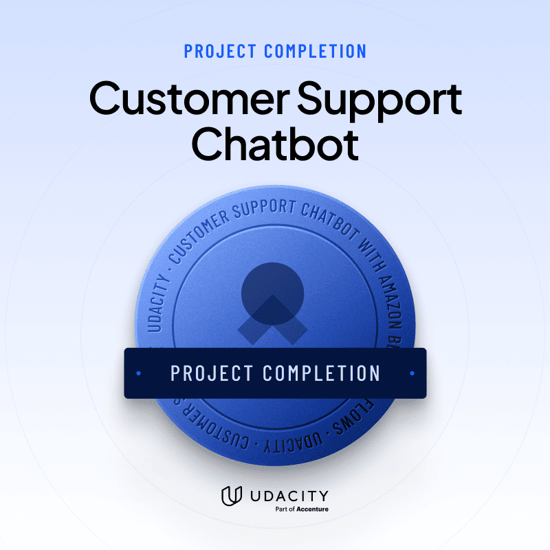

# Customer Support Chatbot avec Amazon Bedrock AgentCore

<p align="center">
  
</p>

Chatbot de support client pour une boutique en ligne, construit sur **Amazon Bedrock AgentCore** (harness managé + Gateway MCP) avec le modèle **Amazon Nova Pro**. Projet réalisé dans le cadre du parcours *Agentic AI Engineer* d'Udacity.

Le chatbot classe chaque message client dans l'une de trois catégories :

| Catégorie | Comportement |
|---|---|
| **Bug report** | Collecte, une question à la fois, la description, les étapes de reproduction et l'environnement, puis appelle l'outil `create_bug_report` et renvoie le numéro de ticket. |
| **Question plateforme** | Répond **uniquement** à partir de la FAQ (`online_shop_faq.md`). Si la réponse n'y figure pas, redirige vers le support humain (1-800-555-0199). |
| **Autre demande** | Partenariats, litiges, réclamations… : redirige poliment vers le support humain. |

## Architecture

```
Utilisateur ──► chat.py ──► AgentCore Harness (Nova Pro + system prompt + FAQ)
                                   │
                                   ▼ (outil MCP)
                            AgentCore Gateway
                                   │
                                   ▼
                     Lambda create_bug_report ──► DynamoDB (tickets)
```

- **CloudFormation** (`cloudformation-tool.yaml`) : table DynamoDB, fonction Lambda et rôles IAM (Lambda, Gateway, exécution du harness).
- **Gateway AgentCore** (`setup_gateway.py`) : expose la Lambda comme outil MCP `bugreports___create_bug_report` (auth AWS_IAM).
- **Harness AgentCore** (`create_harness.py`) : agent managé, prompt système (`system_prompt.txt`) dans lequel la FAQ est injectée via `{{FAQ}}`, décodage glouton pour un appel d'outil fiable.
- **Évaluation** (`cloudformation-testing.yaml`, `generate-eval-dataset.py`) : bucket S3 + rôle IAM pour **Bedrock Evaluations** en mode *LLM-as-a-judge* (bring-your-own-inference).

## Structure du dépôt

| Fichier | Rôle |
|---|---|
| `cloudformation-tool.yaml` | Infrastructure de l'outil (DynamoDB, Lambda, IAM) |
| `cloudformation-testing.yaml` | Infrastructure d'évaluation (S3, rôle Bedrock Evaluations) |
| `create_bug_report.py` | Code de la Lambda (miroir du code inline du template) |
| `setup_gateway.py` | Création de la Gateway et de sa cible Lambda |
| `create_harness.py` | Création / mise à jour du harness |
| `system_prompt.txt` | Prompt système et règles de routage |
| `online_shop_faq.md` | Base de connaissances FAQ |
| `chat.py` | Chat interactif en terminal avec le harness |
| `harness-tests.json` | Cas de test (bug, FAQ, autre demande) |
| `generate-eval-dataset.py` | Génère le dataset JSONL pour Bedrock Evaluations |
| `cleanup_agentcore.py` | Supprime les ressources AgentCore |
| `Customer Support Chatbot with Amazon Bedrock AgentCore-1.pdf` | Rapport avec captures d'écran des tests |

## Mise en route

Prérequis : Python 3, identifiants AWS configurés, région `us-east-1`, accès au modèle Amazon Nova Pro.

```bash
pip install -r requirements.txt

# 1. Infrastructure de l'outil
aws cloudformation deploy --template-file cloudformation-tool.yaml \
  --stack-name bug-report-tool-stack --capabilities CAPABILITY_NAMED_IAM --region us-east-1

# 2. Gateway + harness
python setup_gateway.py
python create_harness.py

# 3. Discuter avec le chatbot
python chat.py
```

## Évaluation

```bash
aws cloudformation deploy --template-file cloudformation-testing.yaml \
  --stack-name bug-report-testing-stack --capabilities CAPABILITY_NAMED_IAM --region us-east-1

python generate-eval-dataset.py --tests-json harness-tests.json
```

Le JSONL produit est chargé dans S3 puis évalué par un job **Bedrock Evaluations** (LLM-as-a-judge). Les résultats sont dans `support-chatbot-eval-run-1/` et dans le rapport PDF.

## Nettoyage

```bash
python cleanup_agentcore.py
aws cloudformation delete-stack --stack-name bug-report-tool-stack --region us-east-1
aws s3 rm s3://<EvalDatasetBucketName> --recursive
aws cloudformation delete-stack --stack-name bug-report-testing-stack --region us-east-1
```

> `agentcore_config.json` (généré, contient les ARN du compte AWS) est exclu du dépôt via `.gitignore`.

## Auteur

Delchere Dontsa — [@delchere](https://github.com/delchere)
